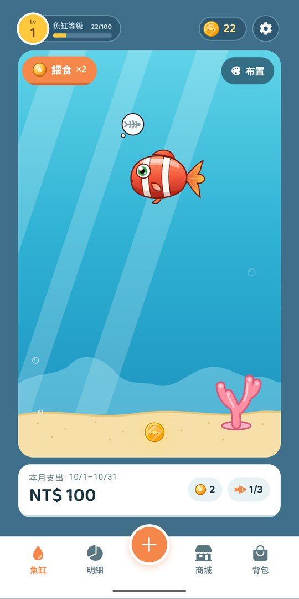
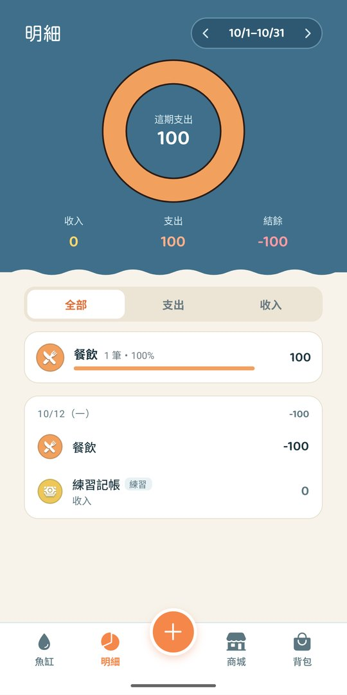
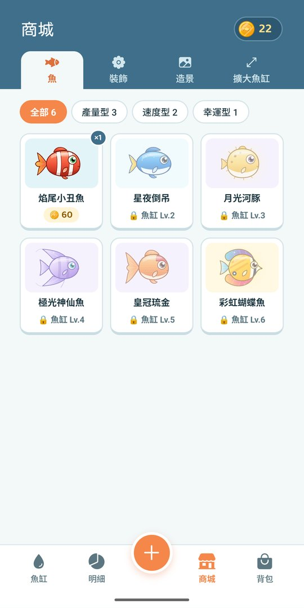
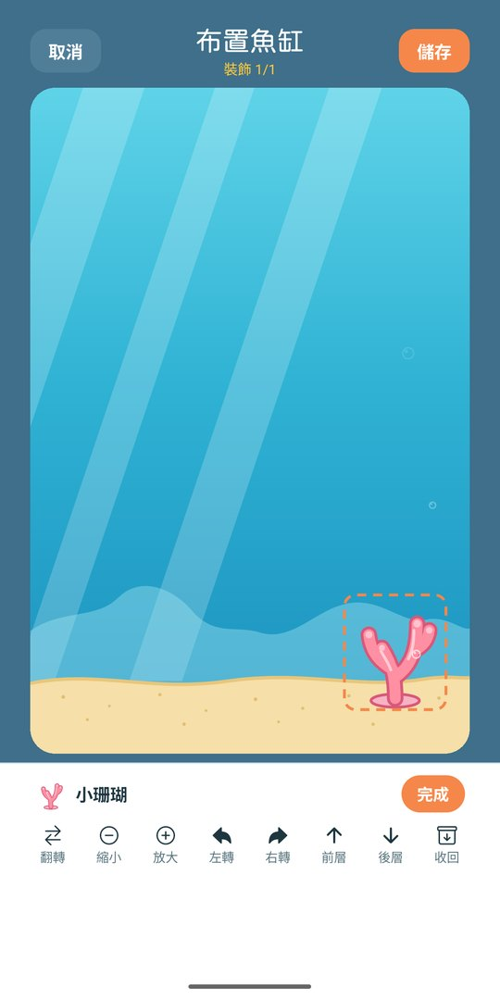

<p align="center">
  
</p>

<h1 align="center">記帳魚缸 Fish Note</h1>

<p align="center">
  <b>記一筆帳，養一缸魚。</b><br>
  記帳換魚糧，餵魚撿金幣，再用金幣把魚缸布置成你的小海洋。
</p>

<p align="center">
  
  
  
  
  
</p>

---

## 📱 預覽

<p align="center">
  
  
  
  
</p>

<p align="center"><sub>魚缸 ・ 明細統計 ・ 商城 ・ 布置模式</sub></p>

## 💡 為什麼做這個

記帳最難的不是記，是**持續記**。記帳魚缸用輕度遊戲化的養成循環，讓「每天打開記帳」變成想做的事：

```
記帳 → 拿到魚糧 → 餵魚 → 魚排出金幣 → 買魚和裝飾 → 魚缸更漂亮 → 繼續記帳
```

記帳是主功能，遊戲是動機，**記一筆不到 10 秒**，遊戲不會擋在記帳前面。

## ✨ 功能

| | 功能 | 說明 |
| --- | --- | --- |
| 🧾 | 快速記帳 | 數字鍵盤、分類、日期一次完成；可自訂分類名稱、顏色與圖示 |
| 🐟 | 餵魚養成 | 每筆帳依分類換成對應顏色的魚糧，在水中點一下或拖曳投放 |
| 🪙 | 金幣經濟 | 魚吃飽後排出金幣，點擊收集；魚會升級，等級越高產出越好 |
| 🛍️ | 商城與收集 | 魚、海草、珊瑚、寶箱、會動的裝飾、水景背景與氛圍 |
| 🎨 | 布置魚缸 | 拖曳擺放裝飾，可翻轉、旋轉、縮放，調整前後層 |
| 📊 | 明細統計 | 收據風格的每日明細，分類圓餅圖一眼看出錢花去哪 |
| 📤 | 分享魚缸 | 把魚缸做成圖片或 6 秒短影片分享給朋友 |
| 🔒 | 資料只在手機 | 免註冊、免登入；可匯出 / 匯入備份檔，換手機也不怕 |

## 🛠️ 技術

| 項目 | 使用技術 |
| --- | --- |
| 框架 | Expo（React Native）+ TypeScript，一份程式碼支援 iOS / Android |
| 路由 | Expo Router |
| 水族箱場景 | React Native Skia 繪製 + Reanimated 動畫（跑在 UI 執行緒） |
| 本機資料 | expo-sqlite；測試時以 sql.js 執行同一份 SQL |
| 通知 | expo-notifications（每日記帳提醒） |
| 原生模組 | 自製 Android 原生模組錄製魚缸分享影片（MediaCodec） |
| 測試 | Jest + React Native Testing Library |
| 建置 / 部署 | EAS Build、本機 Gradle 打包；網頁試玩版部署於 Zeabur |

## 🤖 開發方式

這個專案以 **Claude Code AI 協作開發**，並採用文件驅動的流程：

- **先寫規格再實作**：產品概述、遊戲經濟、美術風格、技術架構都先成文
- **分階段推進**：拆成 50 個開發階段，每個階段都有目標、驗收清單與測試紀錄
- **決策可追溯**：55 條決策紀錄，記下每個取捨的原因（例如從 Flutter 改用 Expo）
- **品質把關**：283 個自動化測試，搭配 TypeScript 型別檢查與 ESLint

從第一份規格到 1.11.0 版約三週。

## 📦 狀態與下載

目前在**內部測試**中，正在準備上架 Google Play，上架後會在這裡補上下載連結。

> 原始碼目前不公開，此 repo 僅作作品展示。

---

<p align="center">
  Made by <a href="https://hi-alan-liu.github.io/profile/">Alan Liu</a>
</p>
