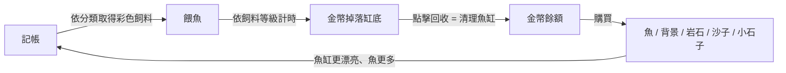

# 01 產品概述

Fish Note 是一款 iOS / Android 雙平台的記帳 App，用可愛水族箱養成讓「每天記帳」變成想打開的習慣。使用者每記一筆帳就拿到飼料，餵魚後魚會排出金幣，撿金幣再買魚和裝飾，把魚缸布置成自己的樣子。

- **目標用戶**：想養成記帳習慣但容易半途而廢的年輕族群（18–35 歲），偏好療癒、輕度遊戲化的體驗。
- **核心價值**：記帳是主功能，遊戲是動機；遊戲不能妨礙記帳流程（記一筆 ≤ 10 秒）。
- **成功指標**：7 日留存、每週平均記帳筆數、每日開啟次數（回來撿金幣）。

## 核心循環

1. 記帳 → 依記帳分類取得對應顏色的飼料
2. 餵魚 → 魚開始消化，依飼料等級計時
3. 時間到 → 金幣掉落到缸底（魚的排泄物概念）
4. 點擊金幣回收 → 等同清理魚缸
5. 用金幣購買魚、背景、岩石、沙子、小石子等裝飾
6. 魚缸越漂亮、魚越多 → 更有動力繼續記帳
