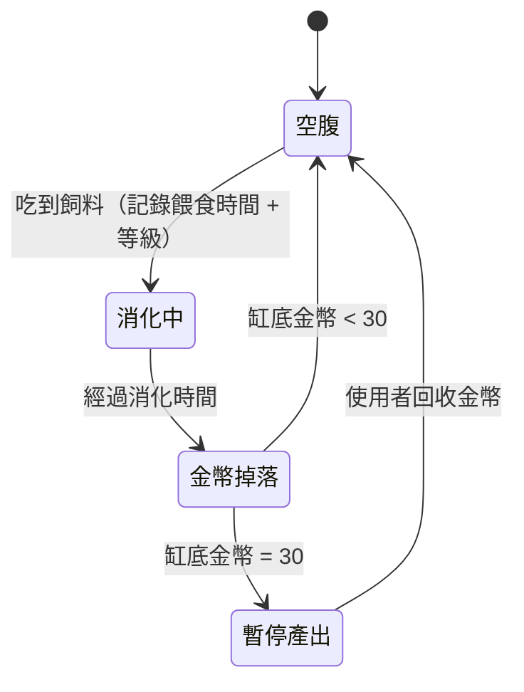

# 02 核心玩法與經濟系統

飼料「顏色」代表記帳分類，飼料「等級」決定消化時間與金幣產量；等級越高、等越久、每小時收益越高，鼓勵使用者隔幾小時回來看一次。

## 記帳分類 → 飼料顏色

| 記帳分類 | 飼料顏色 | 飼料造型（建議） |
| --- | --- | --- |
| 餐飲 | 橘色 | 圓顆粒 |
| 交通 | 藍色 | 圓顆粒 |
| 購物 | 粉紅色 | 星星顆粒 |
| 娛樂 | 紫色 | 星星顆粒 |
| 居家 / 帳單 | 綠色 | 方塊顆粒 |
| 醫療 / 學習 | 青色 | 方塊顆粒 |
| 其他支出 | 灰白色 | 圓顆粒 |
| 收入 | 金黃色 | 愛心顆粒 |

顏色之外再搭配不同造型，色弱使用者也分得出來。第一階段顏色只有視覺區分；第二階段可加入「魚種偏好」（例：小丑魚吃橘色飼料產量 +20%）。

## 飼料等級 → 金幣產出

| 等級 | 消化時間 | 金幣產量 | 每小時效率 | 來源 |
| --- | --- | --- | --- | --- |
| A | 1 小時 | 10 | 10 / 小時 | 需求範例 |
| B | 2 小時 | 30 | 15 / 小時 | 需求範例 |
| C | 4 小時 | 80 | 20 / 小時 | 建議值 |
| D | 8 小時 | 200 | 25 / 小時 | 建議值 |

### 等級怎麼決定（建議方案，待確認）

- 每記一筆帳得 1 份 A 級飼料。
- 連續記帳天數獎勵：連續 3 天當天第一筆得 B、7 天得 C、30 天得 D。
- 同色同級 3 份可合成 1 份下一級（第二階段）。

## 餵食與金幣掉落規則

1. 使用者從飼料列拖曳或點選飼料，投入水中，飼料緩慢下沉。
2. 空腹的魚游過去吃掉；一隻魚同時只消化一份飼料，魚越多可並行產出越多。
3. 消化中的魚頭上顯示小進度圈，點魚可看剩餘時間。
4. 時間到，魚「噗」一聲排出金幣，金幣沉到缸底並微微發光。
5. 使用者點擊金幣回收（金幣飛向上方餘額列）；連續點擊有 combo 音效。
6. 缸底金幣上限 30 枚，滿了魚暫停產出並提示「該清理魚缸囉」，製造回訪理由。
7. App 關閉時仍照實際時間計算，重開時一次補算掉落。

## 魚缸名額與背包

- 只有**魚缸中的魚**會吃飼料、會餓、會產金幣；背包中的魚不參與（D-05）。
- 初始名額：魚 1、裝飾 1，以金幣擴充，詳見 [features/shop.md](features/shop.md)。
- 每隻魚有飽足度 0–100%：吃下飼料為 100%，消化完後 8 小時降到 0% 顯示「肚子餓」；新魚第一次放入魚缸為 50%；收進背包時凍結。不影響產量、不會死亡，詳見 [features/fish-mood.md](features/fish-mood.md)。

## 特殊飼料

| 飼料 | 取得 | 效果 |
| --- | --- | --- |
| 新手飼料（金色發光） | 教學第一筆練習記帳，帳號限一次 | 吃下**立即**掉落 5 金幣 |

## 防刷規則

- 每日前 10 筆記帳才給飼料，避免亂記刷飼料。
- 同一筆帳刪除後重記不重複給飼料；金額為 0 不給。
- **唯一例外**：新手教學的 0 元練習記帳會給 1 份新手飼料（帳號限一次，D-04）。
