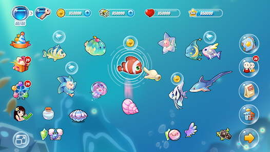

# 03 美術風格

> **風格基準：小丑魚「橘橘」**（`prototypes/clownfish/index.html`）。
> 之後所有的魚、裝飾、UI 圖示，都以這隻魚的造型語言為準；新角色設計完成後，請和橘橘並排檢查是否同一個世界。

風格定調為「明亮、圓潤、Q 版、貼紙感」的卡通海底：深棕描邊 + 糖果色漸層填色 + 大眼睛 + 簡單高光。

## 1. 角色造型規範（以橘橘為基準）

### 1.1 比例

| 項目 | 規範 | 橘橘實際值 |
| --- | --- | --- |
| 身形 | 圓胖水滴形，頭在前、尾端收窄；長寬比約 1.3 : 1 | 身體 104 × 86（viewBox 164 × 124） |
| 眼睛 | 特大，直徑約為身高的 30%，位於頭部前上方 | 半徑 13，瞳孔半徑 8.5 |
| 尾鰭 | 約身長的 1/3，左右對稱的雙葉形 | 從 x = -44 延伸到 -82 |
| 背鰭 / 腹鰭 | 小而圓，藏在身體後面，只露出一半 | — |
| 胸鰭 | 畫在身體前面，是主要的「表情」鰭，會拍動 | — |
| 嘴 | 很小，位於最前端，靠表情切換而非尺寸表現 | 微笑弧線寬約 8 |

### 1.2 線條與上色

| 項目 | 規範 |
| --- | --- |
| 描邊顏色 | 深咖啡 `#2B1D1A`（不用純黑） |
| 描邊粗細 | 2.2–2.6（以 164 寬畫布計），身體外框最粗、胸鰭最細 |
| 線條端點 | 圓角接合（round join / round cap） |
| 主體填色 | 放射漸層，光源在左上：亮色 → 主色 → 暗色（橘橘：`#FFB066` → `#FF7A2E` → `#F05A14`） |
| 斑紋 | 白色條紋 + 同樣的深咖啡描邊，被身體輪廓裁切 |
| 高光 | 身體上方一道半透明白色橢圓（不透明度約 28%）；眼睛兩個白點（大 + 小） |
| 腮紅 | 粉紅橢圓 `#FF5F8A`，不透明度 55%，在眼睛下後方 |
| 胸鰭 | 比主色淺一階（橘橘 `#FF9A52`） |
| 禁止 | 寫實鱗片、細碎紋理、硬陰影、純黑描邊、銳角 |

### 1.3 表情元件

每隻魚都要準備以下可切換的部件，動畫時以顯示 / 隱藏或縮放切換：

| 部件 | 狀態 |
| --- | --- |
| 眼睛 | 一般、眨眼（垂直縮成 10%）、驚嚇（放大 115%，瞳孔縮成 4.2） |
| 嘴巴 | 微笑弧線、張嘴（深色橢圓 + 粉紅舌頭）、O 型小嘴 |
| 汗滴 | 淺藍水滴 `#BFEAFF`，描邊 `#3A87B5`，位於頭頂後方 |
| 頭上表情泡泡 | 驚嘆號（白底紅字圓泡）、愛心（粉紅 `#FF6FA3`）、魚骨頭（肚子餓）、✕（吃不下），見 [fish-mood](features/fish-mood.md) |

### 1.4 新魚種設計流程

1. 沿用橘橘的身形骨架與部件結構（尾、背鰭、腹鰭、身體、斑紋、眼、嘴、胸鰭、汗滴）。
2. 只換「輪廓微調 + 配色 + 斑紋」，例如藍倒吊換藍色漸層與黑色紋路、河豚把身形改圓並加小刺。
3. 描邊顏色、粗細、高光、眼睛畫法不變，確保風格統一。
4. 與橘橘並排放進魚缸檢查大小與辨識度後才定稿。

## 2. 動作規範

所有魚共用同一套動作狀態，數值可依魚種個性微調（例如河豚游得慢、藍倒吊衝得快）。

| 動作 | 觸發 | 表現 | 時長 | 速度（800 寬魚缸） |
| --- | --- | --- | --- | --- |
| 游泳 Swim | 預設 | 隨機選點游動、上下浮動約 3.5 px、尾巴擺動幅度隨速度增加、胸鰭拍動、每 2–5 秒眨眼、轉身時壓扁翻面 | 循環 | 約 55 px/s |
| 覓食 Seek | 缸內有飼料 | 游向最近的飼料，接近時嘴巴張開 | 直到對準 | 120 px/s |
| 吃東西 Eat | 嘴巴碰到飼料 | 嘴巴開合 3 次（每 0.18 秒切換），飼料吸入縮小，肚子鼓起約 9%，冒出愛心 | 1.5 s | 停住 |
| 受驚 Startle | 點擊魚 | 原地彈跳（縱向拉長 20%）、眼睛放大、O 型嘴、汗滴、驚嘆號 | 0.3 s | 停住 |
| 逃跑 Flee | 受驚結束 | 往遠離點擊處衝刺，身體拉長，尾巴高速擺動，留下氣泡 | 1.1 s | 460 px/s |
| 冷靜 Recover | 逃跑結束 | 減速、汗滴淡出，之後回到游泳 | 1.2 s | 35 px/s |

正式製作建議用 **Rive**：以上部件拆成骨架與狀態機，程式只需切換狀態（swim / eat / scared）並控制位置。

## 3. 場景與裝飾

- **水**：湖水藍漸層（上 `#5FD3E8` → 中 `#2FB2D4` → 下 `#1A8FBD`），上方一層淺色光暈，3 道緩慢明暗變化的光束。
- **地板**：奶油沙色 `#F6DFA8`，上緣波浪線 `#E8C67C`；散落糖果色小石子（粉、藍、紫、黃、綠）。
- **裝飾**：與魚相同的描邊語言（帶色系描邊 2.5–3），例如海草綠 `#3FBF7F` 配描邊 `#2A8D5B`、岩石 `#9DB4C4` 配描邊 `#6F8899`、貝殼 `#FFD6E2` 配描邊 `#E79AB2`。
- **環境動態**：海草左右搖擺 ±5°（3.7–5.1 秒一循環、彼此錯開），角落持續冒小氣泡。
- **飼料**：圓形顆粒、糖果色，帶內陰影與高光；顏色對應記帳分類（見 [02 核心玩法與經濟系統](02-gameplay-economy.md)）。
- **裝飾類型**：背景（整片替換）、地板（沙子 / 小石子）、大件擺設（岩石、珊瑚、沉船）、小件（貝殼、海草、氣泡石）。

## 4. 介面

- **App 以直式為主**（D-03）。原型魚缸為橫式 16:10，正式版水族箱改為直式比例，填滿首頁中段；裝飾座標以 0–1 比例儲存，適應不同螢幕。
- 上方餘額列（金幣、飼料庫存）、右側圓形功能鈕（記帳、商店、報表、設定），按鈕大、圓、可單手操作。
- 狀態標籤用膠囊形（全圓角），按鈕圓角約 14、底部帶 3 px 內陰影做出「可按」的厚度感。
- 字體：標題用圓體（Huninn），內文 Noto Sans TC，數字用 Baloo 2。
- 記帳頁沿用同樣的圓角與糖果色，但以清楚易讀為優先，不加過多動畫。
- 必須支援「減少動態效果」系統設定：關閉光束與海草等環境動畫，保留使用者觸發的動作。
