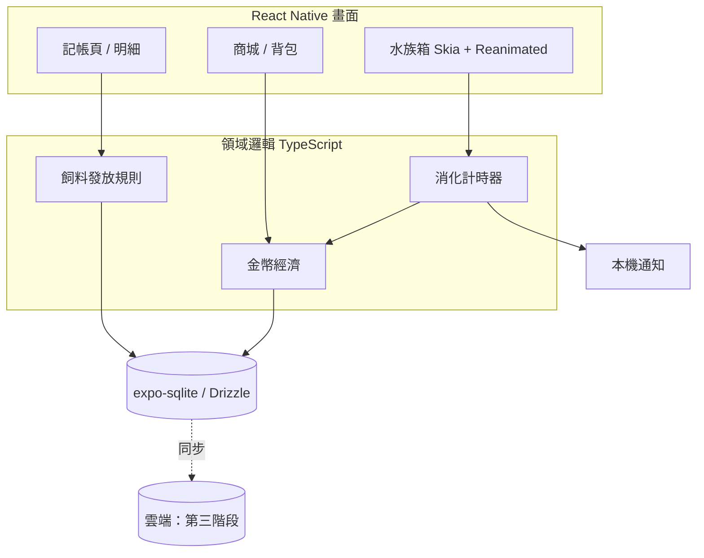

# 04 技術架構

採用 **Expo（React Native）+ TypeScript**，以 **EAS Build** 線上打包 iOS / Android（D-20，取代原本的 Flutter 方案）。記帳畫面用 React Native 元件，水族箱用 React Native Skia 繪製、Reanimated 驅動動畫。

| 項目 | 技術 | 理由 |
| --- | --- | --- |
| 框架 | Expo（React Native）+ TypeScript | 一份程式碼雙平台；EAS 線上打包，不需要 Mac 也能出 iOS |
| 線上打包 | EAS Build | 雲端建置 APK / AAB / IPA |
| 線上更新 | EAS Update | 修正文案、數值、小錯誤可直接推送，不必每次送審 |
| 路由 | Expo Router（底部分頁） | 檔案式路由，分頁與彈出頁好管理 |
| 水族箱場景 | React Native Skia + Reanimated | 魚、飼料、金幣以 Canvas 繪製，動畫跑在 UI 執行緒，維持 60 fps |
| 本機資料庫 | expo-sqlite + Drizzle ORM | SQL 查詢與統計；Drizzle 提供型別安全與 migration，測試時改用 sql.js 跑同一份 schema |
| 圖表 | Skia 自繪圓餅圖 | 與水族箱同一套繪圖，顏色與飼料色一致，不多裝圖表套件 |
| 推播通知 | expo-notifications | 每日提醒、金幣掉落本機通知 |
| 備份 | expo-file-system、expo-sharing、expo-document-picker | 匯出 / 匯入 `.fishnote` 備份檔 |
| 測試 | Jest（jest-expo）+ React Native Testing Library | 規則邏輯單元測試、畫面元件測試 |
| 雲端（第三階段） | Firebase 或 Supabase | 帳號、跨裝置同步、伺服器時間驗證、內購 |

## 架構

## 離線計時

每份餵食存「餵食時間 + 等級」，重開時以「現在 − 餵食時間」判斷是否掉落，不需要背景執行。

## 調時間作弊

第一階段純本機，偵測到系統時間往回跳就暫停產出；第三階段改以伺服器時間為準。

## 主要資料表

| 資料表 | 用途 | 主要欄位 |
| --- | --- | --- |
| Transaction | 記帳紀錄 | id, amount(整數), currency, type(收/支), categoryId, date, note, feedGranted, **isTutorial** |
| Category | 分類 | id, name, color(= 飼料色), icon |
| FeedInventory | 飼料庫存 | color, level(A/B/C/D/**tutorial**), quantity |
| Fish | 擁有的魚（同種可多隻） | id, speciesId, **inTank**(bool), **satiety**(0–100), **satietyAt**(記錄時間), **everPlaced**(是否放入過魚缸，控制五分飽只套用一次), digestingFeedingId |
| Feeding | 餵食紀錄 | id, fishId, feedColor, feedLevel, fedAt, readyAt, **remainingMs**(收回背包時保存) |
| DroppedCoin | 缸底金幣 | id, amount, x, droppedAt |
| Wallet | 餘額 | coins |
| Tank | 魚缸 | id, backgroundId, **floorId**(沙子 / 小石子), **fishSlots**, **decoSlots** |
| InventoryItem | 擁有的裝飾 / 背景 | itemId, quantity |
| Placement | 裝飾擺放 | id, itemId, **x, y（0–1 比例座標）**, layer, flipped |
| Settings | 設定 | currency, **cycleStartDay**, reminderEnabled, reminderTime, coinNotifyEnabled, soundEnabled |
| TutorialProgress | 教學進度 | step, completed, skipped |

商品目錄（ShopCatalog）不存資料庫，以 JSON 設定檔隨 App 發佈。

## 備份

- 備份檔 `.fishnote` = ZIP（`manifest.json` + `data.json`），涵蓋上表所有資料表，附格式版本與 HMAC 檢查碼。
- 每日本機快照保留 7 份；還原前自動快照；還原在單一交易中完成。
- 詳見 [features/backup.md](features/backup.md)。
