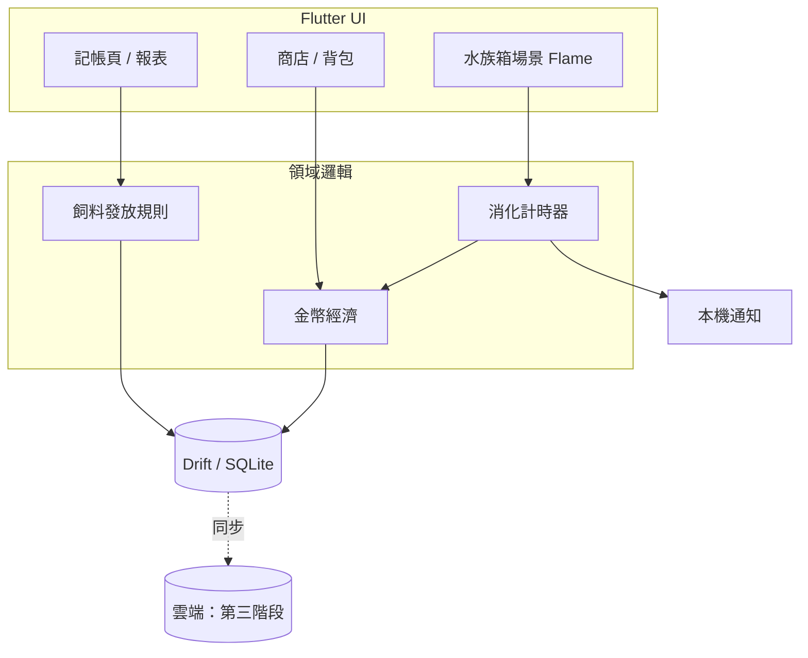

# 04 技術架構

建議使用 Flutter + Flame：一份程式碼同時出 iOS / Android，記帳表單用 Flutter 元件，水族箱動畫用 Flame 2D 遊戲引擎，兩者在同一個 App 內無縫切換。

| 項目 | 建議技術 | 理由 |
| --- | --- | --- |
| 跨平台框架 | Flutter | 自帶繪圖引擎，動畫效能穩定，雙平台外觀一致 |
| 水族箱場景 | Flame + Rive / Spine | 魚的游動、餵食、金幣掉落與點擊判定 |
| 本機資料庫 | Drift (SQLite) | 記帳資料需要查詢與統計，SQL 最合適 |
| 狀態管理 | Riverpod | 記帳、庫存、餘額狀態跨頁共享 |
| 推播通知 | flutter_local_notifications | 「金幣掉下來囉」「今天還沒記帳」本機提醒 |
| 雲端（第三階段） | Firebase 或 Supabase | 帳號、跨裝置同步、伺服器時間驗證、內購 |

## 架構

## 離線計時

每份餵食存「餵食時間 + 等級」，重開時以「現在 − 餵食時間」判斷是否掉落，不需要背景執行。

## 調時間作弊

第一階段純本機，偵測到系統時間往回跳就暫停產出；第三階段改以伺服器時間為準。

## 主要資料表

| 資料表 | 用途 | 主要欄位 |
| --- | --- | --- |
| Transaction | 記帳紀錄 | id, amount(整數), currency, type(收/支), categoryId, date, note, feedGranted, **isTutorial** |
| Category | 分類 | id, name, color(= 飼料色), icon |
| FeedInventory | 飼料庫存 | color, level(A/B/C/D/**tutorial**), quantity |
| Fish | 擁有的魚（同種可多隻） | id, speciesId, **inTank**(bool), **satiety**(0–100), **satietyAt**(記錄時間), **everPlaced**(是否放入過魚缸，控制五分飽只套用一次), digestingFeedingId |
| Feeding | 餵食紀錄 | id, fishId, feedColor, feedLevel, fedAt, readyAt, **remainingMs**(收回背包時保存) |
| DroppedCoin | 缸底金幣 | id, amount, x, droppedAt |
| Wallet | 餘額 | coins |
| Tank | 魚缸 | id, backgroundId, **floorId**(沙子 / 小石子), **fishSlots**, **decoSlots** |
| InventoryItem | 擁有的裝飾 / 背景 | itemId, quantity |
| Placement | 裝飾擺放 | id, itemId, **x, y（0–1 比例座標）**, layer, flipped |
| Settings | 設定 | currency, **cycleStartDay**, reminderEnabled, reminderTime, coinNotifyEnabled, soundEnabled |
| TutorialProgress | 教學進度 | step, completed, skipped |

商品目錄（ShopCatalog）不存資料庫，以 JSON 設定檔隨 App 發佈。

## 備份

- 備份檔 `.fishnote` = ZIP（`manifest.json` + `data.json`），涵蓋上表所有資料表，附格式版本與 HMAC 檢查碼。
- 每日本機快照保留 7 份；還原前自動快照；還原在單一交易中完成。
- 詳見 [features/backup.md](features/backup.md)。
