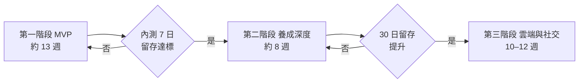

# 05 三階段總覽

先驗證核心循環，再擴充內容，最後上雲端。每個階段結束都有留存門檻，達標才進下一階段；未達標就先調整數值與核心循環。

| 階段 | 預估時程 | 重點 | 進入下一階段門檻 |
| --- | --- | --- | --- |
| [第一階段 MVP](06-phase-1-mvp.md) | 約 13 週 | 記帳統計、餵魚撿金幣、商城擴充、背包、DIY、新手教學、備份還原；純本機、直式 | 內測 7 日留存達標 |
| [第二階段 養成深度](07-phase-2-growth.md) | 約 8 週 | 飼料 C/D、合成、圖鑑；預算、自訂分類、報表 | 30 日留存提升 |
| [第三階段 雲端與社交](08-phase-3-cloud-social.md) | 10–12 週 | 帳號同步、好友參觀；會員訂閱、裝飾內購 | — |

